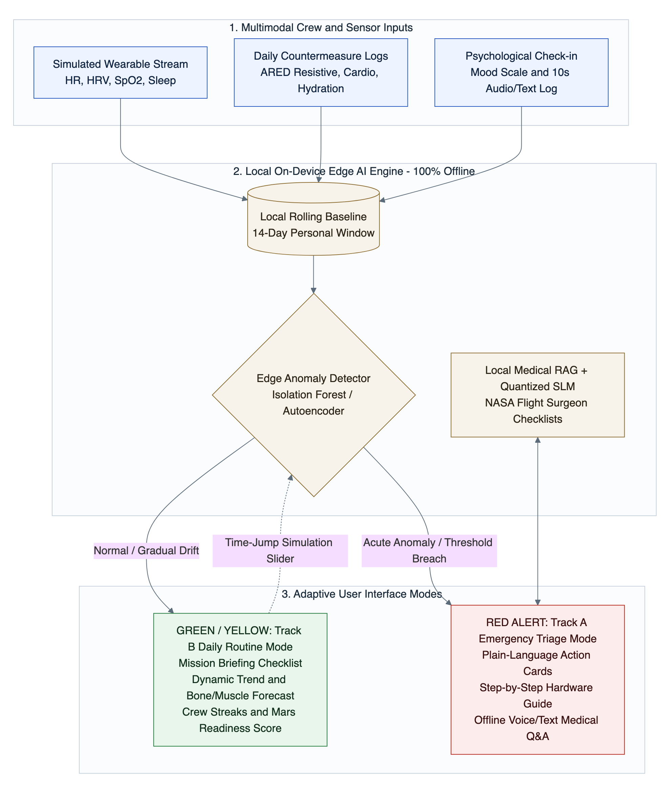

# AstroPulse: Offline Health Monitoring & Early Warning for Astronauts

**NASA Space Apps Challenge 2026** | Team **Spacego** | *Challenge: [Create Health Monitoring Software for Astronauts on Space Missions](https://www.spaceappschallenge.org/2026/challenges/health-monitoring-software/)*

**🚀 Live demo: [astropulse-b5b55.web.app](https://astropulse-b5b55.web.app/#/)** · demo astronaut: **Cmdr. Chris Singh**, mission day 140 of 180

AstroPulse is an offline-first tablet app that helps an astronaut on a long-duration mission (Moon, Mars, deep-space transit) **check their own health, see where their body is heading, and know exactly what to do**, without waiting for Earth. Deep-space crews face communication delays of up to ~20 minutes each way and usually have no physician on board, so the astronaut is both the patient and the first responder.

The app opens on **bone health**, the slowest and least visible risk on a long mission, and keeps general vitals on a separate **Health** tab.

AstroPulse has two modes:

* **Daily Mode** – a 2-minute self check-in, status against the astronaut's *own* space baseline, plain-language guidance, and a forecast of where bone, heart, sleep and radiation dose are heading by mission end.
* **Triage Mode** – when two vital signs leave their safe range together, the app switches to a full-screen Red Alert with numbered steps a non-doctor crewmate can follow, 100% offline.

> Prototype only, not a medical device. All crew data is simulated.

---

## Table of Contents
1. [Core Concept & Mission Value](#1-core-concept--mission-value)
2. [System Architecture](#2-system-architecture)
3. [Key Features](#3-key-features)
4. [Health Indicators](#4-health-indicators)
5. [Data Sources & Simulated Mission Data](#5-data-sources--simulated-mission-data)
6. [Engine: Baseline, Status, Forecast, Watchdog](#6-engine-baseline-status-forecast-watchdog)
7. [Tech Stack](#7-tech-stack)
8. [Hackathon Demo Scenario](#8-hackathon-demo-scenario)
9. [Run It Locally & Deploy](#9-run-it-locally--deploy)
10. [What Is Real vs Simulated](#10-what-is-real-vs-simulated)
11. [Changelog (hackathon weekend)](#11-changelog-hackathon-weekend)

---

## 1. Core Concept & Mission Value

NASA's Human Research Program (HRP) groups the dangers of spaceflight into five hazards: **space radiation, isolation and confinement, distance from Earth, altered gravity fields, and hostile closed environments**. Over long missions these can bring immune changes, bone loss, cardiovascular changes and behavioral health problems, and the challenge notes that astronauts carry much of the responsibility for spotting these changes in themselves.

Astronauts launch healthy, so AstroPulse does **early warning and prevention, not diagnosis**. Every day it answers three questions for the astronaut:

1. **Am I OK, for me, in space?** Readings are compared to the astronaut's own 14-day baseline, not Earth textbook ranges.
2. **Where am I heading?** A forecast shows the trend to mission end if nothing changes, and how the astronaut's own actions (e.g. exercise) change it.
3. **What do I do now?** Clear actions: self-care → tell the crew medical officer → escalate to the flight surgeon.

---

## 2. System Architecture



---

## 3. Key Features

### App layout
| Tab | What it shows |
| :--- | :--- |
| **Bone** (home) | Bone health for the selected astronaut: plain-language summary, **enter bone biomarkers** + **report back pain/posture** at the top, pre-flight / in-flight / post-flight density cards, spine density chart (ground → flight → recovery), pattern and exercise alerts, bone signals, tracking table, device and ultrasound entry, ground-doctor review, test schedule |
| **Health** | General check-ups: heart rate, blood pressure, sleep, mood & stress, temperature, blood sugar, radiation dose, plus the morning check-in prompt |
| **Check-in** | Step-by-step morning readings with re-measure prompt |
| **Forecast** | Time-jump slider, day 1 → day 180 |
| **Body** | Body map of hazards |
| **Trends** | 30-day trends against the personal space baseline |
| **Audit** | Hash-chained log of every reading, report and downlink |

### Bone health (home page)
* **Bone biomarker entry:** blood **CTX** (bone breakdown, ng/mL) and **P1NP** (bone building, ng/mL); urine **NTx** (nmol BCE/mmol Cr) and **calcium** (mg/day), entered together from the same sample. Values outside a wide plausibility range ask the user to check units; these ranges catch typos and are **not clinical limits**.
* **Where entered values go:** the Tracking table (latest vs first on-board entry, no thresholds), the audit trail (`Bone biomarkers entered`), the next report to ground doctors, and — for urine samples — the urine series that feeds the bone-loss signals.
* **Back pain & posture report:** 0–10 pain, location, hunched-posture flag; one of the bone signals.
* **Pattern alert:** fires only when several independent signals agree (exercise, urine NTx, scans + forecast, back pain, posture). One signal alone is treated as noise.
* **Spine density chart:** real NASA bed-rest DXA values for the ground phase, in-flight estimates between scans driven by the exercise log, post-flight recovery from a published NASA half-life fit (276 days).
* **Ultrasound analyzer (concept demo):** image quality checks run for real in the browser; the density estimate is simulated.
* **Send to ground doctors:** builds a downlink packet (scans, reports, biomarkers from the last 30 days) and logs it.
* CTX, P1NP and urine markers are **not direct spine density measurements**; the app says so next to the form.

### Daily Mode (self-assessment)
* **Morning check-in:** one indicator per step, a "how to measure" card for each, large touch targets for use in microgravity.
* **Status against your own baseline:** Normal / Watch / Act, shown with labels and icons (not colour alone).
* **Re-measure before alarm:** a reading far outside the astronaut's normal day-to-day change triggers a re-measure prompt before anything is flagged, cutting false alarms from a slipped cuff or movement.
* **Result + action plan:** 30-day trend with the personal space baseline vs the Earth reference, plus a 3-step plan (self-care → crew medical officer → flight surgeon).
* **"Why?" panels:** every status explains how spaceflight affects that indicator and cites the NASA/CSA source.
* **Forecast with time-jump slider (Day 1 → Day 180):** e.g. projected bone loss at the current exercise pace vs at the exercise target.
* **Nice to have:** clickable body map, countermeasure streaks, crew readiness score.

### Triage Mode (emergency)
* **Watchdog:** checks the live wearable feed every minute against hard limits and a rolling baseline.
* **Red Alert:** full-screen, numbered, plain-language steps for a non-doctor crewmate, always including "contact the crew medical officer". Protocols are **prototype protocols based on public sources**, not real NASA flight-surgeon checklists (those are not public).
* **Stretch:** offline Q&A. Start with scripted answers; a local small language model (WebLLM) is future work because of model size and demo risk.

---

## 4. Health Indicators

| Indicator | Unit | Input | In the challenge brief? | Health risk it covers |
| :--- | :--- | :--- | :--- | :--- |
| Blood pressure | mmHg | Check-in (cuff) | Yes | Cardiovascular |
| Heart rate (resting) | bpm | Wearable | Yes | Cardiovascular |
| Blood sugar (fasting) | mg/dL | Check-in | Yes | Metabolic / nutrition |
| Body temperature | °C | Check-in | Yes | Immune (infection) |
| Sleep | hours | Wearable | Yes | Behavioral health |
| Mood + stress | 1–5 scale | Check-in | Yes (mood) | Behavioral health |
| HRV, SpO2 | ms, % | Wearable | Added | Cardiovascular, emergency |
| Symptoms | list | Check-in | Added | Immune, CO2 exposure |
| Resistance + cardio exercise | minutes | Exercise log | Added | Bone loss, cardiovascular |
| Water intake | mL | Check-in | Added | Kidney-stone risk from bone calcium loss |
| Radiation dose | mSv | Dosimeter feed | Added | Radiation |

| Blood CTX, P1NP | ng/mL | Bone page (lab entry) | Added | Bone turnover (breakdown / building) |
| Urine NTx + calcium | nmol BCE/mmol Cr, mg/day | Bone page (lab entry) | Added | Bone breakdown, kidney-stone risk |
| Back pain, posture | 0–10, yes/no | Bone page | Added | Spine changes |

Bone density cannot be measured with DXA in flight (DXA scans are done on Earth before and after the mission), so bone is tracked from the pre-flight DXA baseline, exercise adherence, in-flight ultrasound (concept), biomarkers and symptoms. The analysis is **descriptive, not clinically validated**: no diagnoses, risk scores or medication advice.

---

## 5. Data Sources & Simulated Mission Data

### NASA and partner resources (from the challenge Resources tab)

| Resource | How AstroPulse uses it |
| :--- | :--- |
| NASA HRP – 5 Hazards of Human Spaceflight | Tags every indicator with the hazards that affect it; shown in "Why?" panels and the body map |
| NASA HRP – Risks of Human Spaceflight | Defines what we watch for and when to escalate (Watch / Act rules, action text) |
| NASA HRP – Ongoing Research in Space | In-flight change rates used for drift and forecasts (e.g. bone loss per month) |
| CSA – Monitoring Radiation for Astronaut Health | Drives the radiation dose tracker and solar-event alerts |

All four are linked from the [challenge Resources tab](https://www.spaceappschallenge.org/2026/challenges/health-monitoring-software/?tab=resources).

### Optional supporting data (cite accurately)

| Source | Notes |
| :--- | :--- |
| [NASA OSDR](https://osdr.nasa.gov) – SpaceX Inspiration4 | Blood measures are in **OSD-569, OSD-570, OSD-571, OSD-575**; OSD-572 is oral/nasal/skin microbial swabs, not vitals. Inspiration4 was a **3-day** mission, so use it only to show the direction of short-term changes, never as a long-mission baseline. |
| [PhysioNet](https://physionet.org) | Earth wearable datasets; optional, only to make minute-level noise in the simulated feed look realistic. |

### Simulated mission data (`/data`)

No public day-by-day in-flight astronaut vitals exist, so `scripts/generate_mission.py` creates a reproducible (fixed seed) 180-day mission for 3 crew members, about **12,000 data points**, small enough to ship inside the app.

| File | Contents | Size |
| :--- | :--- | :--- |
| `crew.json` | Crew profiles + pre-flight baselines (BP, resting HR, DXA bone density, mass) | 3 rows |
| `daily.json` | Daily check-in + wearable summary per crew member (fields in section 4) | 540 rows × 17 fields |
| `environment.json` | Cabin CO2, daily radiation dose, solar-event flag | 180 rows |
| `stream_emergency.json` | 1-minute wearable feed (HR, SpO2, respiration, skin temp) for the Red Alert demo | 120 rows |
| `rules.json` | Per indicator: unit, how to measure, why it changes in space, hazards, Watch/Act rules, actions, source | ~10 objects |
| `triage.json` | Emergency scenarios with numbered steps (prototype) | 3 scenarios |

Each value = personal baseline + slow spaceflight drift + daily noise + injected events. Injected events for the demo story:

| Day | Crew | Event |
| :--- | :--- | :--- |
| 100–125 | Chris | Resistance exercise drops to ~50% of target → bone forecast turns Watch |
| 120–122 | All | Solar particle event → radiation spike |
| 136–140 | Chris | BP rises 128 → 148, headaches, higher CO2, sleep under 6 h |
| 140 | Chris | One bad reading (168/104, slipped cuff) → re-measure prompt |
| Stream min 75 | Crew 2 | HR > 130 bpm and SpO2 < 90% → Red Alert |

---

## 6. Engine: Baseline, Status, Forecast, Watchdog

The core engine is plain, explainable code that runs in the browser with no network calls:

1. **Baseline:** mean and standard deviation of the astronaut's last 14 days per indicator.
2. **Status:** z-score `z = (today − mean₁₄) / sd₁₄` plus hard safety limits from `rules.json` (e.g. Watch after 3 days beyond 2 SD; Act on a hard limit such as SpO2 < 90%).
3. **Re-measure check:** a single jump far beyond the astronaut's normal day-to-day change asks for a re-measure before any alarm.
4. **Forecast:** straight-line projection to mission end; bone = pre-flight DXA value minus the monthly loss rate scaled by exercise adherence; radiation = cumulative dose + average daily dose for the days left.
5. **Watchdog:** per-minute check of the live feed; two vitals out of range together opens Triage Mode.

**Stretch / future work:** an Isolation Forest or autoencoder anomaly model (trained in Python, exported to ONNX / TensorFlow.js) once the core works, and a trained model on real NASA crew data in future. We are explicit in the pitch that today's engine is transparent rules + trend forecasting.

---

## 7. Tech Stack

* **Frontend:** React 19 + Vite, React Router (hash routes), custom dark high-contrast CSS, tablet-first and responsive down to phone width
* **Charts:** Recharts
* **Engine:** JavaScript in the browser, data loaded from bundled JSON; per-crew state in `localStorage`
* **Audit trail:** hash-chained log (each entry includes the previous entry's hash)
* **Backend (optional):** Node/Express mock API (`backend/`) with bone-health, bone-marker and trend analysis; the app falls back to bundled data if it is unreachable
* **Hosting:** Firebase Hosting (`firebase.json`, site `astropulse-b5b55`)
* **Tests:** Vitest (app: 30 tests) + backend analysis tests
* **Data generation:** Python (NumPy, Pandas)
* **Stretch:** scikit-learn → ONNX Runtime Web; WebLLM for offline Q&A

---

## 8. Hackathon Demo Scenario

**Cmdr. Chris Singh, mission day 140 of the transit to Mars. Earth is 18 light-minutes away.** Live: [astropulse-b5b55.web.app](https://astropulse-b5b55.web.app/#/)

0. **Bone home:** Chris's spine is −2.1% vs pre-flight; at the current exercise pace the landing forecast is −2.9%, on the exercise target −2.5%. Enter a urine sample (NTx + calcium) and watch it land in the tracking table, audit trail and bone signals; log back pain; press **Send to ground doctors**.

1. **Daily check-in (Daily Mode):** Chris logs the morning readings. Blood pressure reads 168/104; AstroPulse asks Chris to re-measure (slipped cuff). The confirmed 148/95 is still above *their own* space baseline for the 3rd day, so the app explains why (fluid shift, cabin CO2), cites the NASA source, and gives a self-care plan and a re-check time.
2. **Forecast (time-jump slider):** drag from day 100 to day 180. Missed workouts put the bone forecast in Watch; hitting the exercise target bends the curve back.
3. **Offline emergency (Triage Mode):** turn Wi-Fi off on stage, play the emergency stream. At minute 75 a crewmate's HR passes 130 bpm while SpO2 drops below 90%. AstroPulse detects it locally and opens Red Alert with step-by-step instructions.
4. **"What NASA data did you use?"** Tap a "Why?" panel live to show the NASA/CSA source behind the rule.

---

## 9. Run It Locally & Deploy

```bash
# frontend
cd app
npm install
npm run dev          # http://localhost:5173
npx vitest run       # tests

# optional backend (mock API on :3001)
cd ../backend && npm install && npm start

# deploy (from the repo root)
cd app && npm run build && cd ..
firebase deploy --only hosting
```

Copy `app/.env.example` to `app/.env`. `VITE_ASTRONAUT_MAP=chris:AST-001` maps the demo astronaut to the backend fixture.

---

## 10. What Is Real vs Simulated

| Real | Simulated / prototype |
| :--- | :--- |
| Pre-flight bone values (NASA bed-rest DXA participants) | All in-flight crew readings (`scripts/generate_mission.py`, fixed seed) |
| Post-flight recovery curve (NASA published half-life fit) | Ultrasound density estimate |
| Spaceflight effects, hazards and sources in "Why?" panels (NASA HRP, CSA) | Triage protocols (based on public sources, not real flight-surgeon checklists) |
| Image quality checks on uploaded ultrasound images | Downlink (packet is built and logged, not transmitted) |
| Hash-chained audit trail, re-measure logic, offline engine | No encryption on the downlink yet (planned: CCSDS SDLS with AES-GCM) |

Prototype only, not a medical device.

---

## 11. Changelog (hackathon weekend)

* Home page is now **Bone health**; general vitals moved to a new **Health** tab (`/spine` redirects to home).
* Added **bone biomarker entry**: blood CTX and P1NP, urine NTx and calcium, with typo-catching unit ranges and audit logging.
* Moved biomarker entry and **back pain / posture reporting** to the top of the bone page.
* Urine entries feed the bone signals; all entries go into the tracking table and the ground-doctor report.
* Demo astronaut renamed **Maya → Chris** across data, code, tests and docs.
* Deployed to Firebase Hosting: https://astropulse-b5b55.web.app/#/

